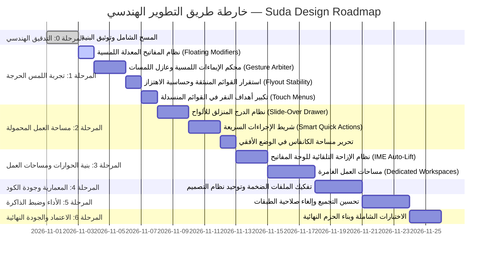

# Suda Design — Master Engineering Implementation Roadmap

**Document:** Engineering Roadmap & Execution Plan  
**Lead:** CTO & Systems Architecture Team  
**Scope:** Architectural Excellence, Touch-Native Ergonomics, Performance & Reliability  
**Target Platform:** Android (Phones & Tablets) & Desktop (Windows, macOS, Linux)

---

## 1. Overview & Phased Execution Strategy

To elevate Suda Design from a desktop-centric port to a world-class, touch-native, high-performance creative design studio, engineering execution is structured into 6 sequential phases. 

Each phase builds directly upon the validated architecture of the preceding phase, guided by the **Definition of Done (DoD)**.

---

## 2. Phase Breakdown & Engineering Deliverables

### Phase 0: Baseline & Repository Engineering Audit
- **Status:** **COMPLETED**
- **Deliverables:**
  - `docs/engineering/ARCHITECTURE_AUDIT.md` (Validated 32 crates, unidirectional layering, zero layering violations).
  - `docs/engineering/UX_AUDIT.md` (Identified 8 critical touch bottlenecks, touch target gaps, missing modifiers).
  - `docs/engineering/PERFORMANCE_AUDIT.md` (Evaluated P1–P79 budgets, Rayon worker clamping, frame pacing).
  - `docs/engineering/CODE_QUALITY_AUDIT.md` (Zero-panic verification, monolithic file analysis).
  - `docs/engineering/IMPLEMENTATION_ROADMAP.md` (This master plan).

---

### Phase 1: Critical Touch UX (Active Phase)
**Objective:** Eliminate the most severe touch interaction friction points immediately.

#### Milestone 1.1: Virtual Floating Modifier Keys (`ModifierHud`)
- **Deliverable:** Centralized on-screen draggable/dockable HUD offering `Shift`, `Alt`, and `Ctrl`.
- **Features:**
  - Tap-to-Lock (latched toggle with visual accent).
  - Hold-to-Modify (thumb-held modifier while other hand/stylus transforms or draws).
  - Centralized integration into `ToolEvent` and `DialogCanvasInput`.
  - Works seamlessly with physical keyboard if attached.

#### Milestone 1.2: Deferred Touch Gesture Arbiter & Touch Slop (`TouchGestureArbiter`)
- **Deliverable:** A spatial-temporal buffer for canvas touches.
- **Features:**
  - 20 ms / 6 pt evaluation window.
  - If a 2nd finger touches down within the window, cancel pending dab and switch smoothly to 2-finger Pan/Zoom.
  - Zero accidental marks on canvas during navigation.
  - High-precision Stylus events bypass the buffer for zero latency.

#### Milestone 1.3: Tool Flyout Long-Press Stabilization
- **Deliverable:** Expand the hit-test tolerance in `crates/ui-egui/src/panels/toolbar.rs`.
- **Features:**
  - Add $\pm 10\text{ pt}$ touch-slop tolerance during $0.35\text{ s}$ long-press.
  - Eliminate accidental aborts caused by finger tremor/jitter.

#### Milestone 1.4: Touch-Friendly Menu Row Heights
- **Deliverable:** Responsive sizing for cascading dropdown menus.
- **Features:**
  - Ensure menu rows on mobile viewports have minimum 38–40 pt hit height.
  - Clean visual separation preventing mis-taps.

---

### Phase 2: Mobile Workspace & Canvas Maximization
**Objective:** Maximize screen real estate on phones and small tablets.

#### Milestone 2.1: Mobile Slide-Over Drawer Dock
- **Deliverable:** Slide-out overlay drawer for Layers, Color, and Properties on phones.
- **Features:**
  - When opened, slides over canvas with subtle backdrop scrim.
  - Automatically dismisses when tapping canvas or dragging handle.
  - Canvas maintains 100% full screen width during editing.

#### Milestone 2.2: Smart Quick Actions Bar (Radial / Floating HUD)
- **Deliverable:** One-tap access to primary repeated operations:
  - `Undo`, `Redo`, `Deselect`, `Invert Selection`, `Duplicate Layer`, `Fit Screen`, `Eyedropper`.

---

### Phase 3: Dialog & Workspace Infrastructure
**Objective:** Fix text input occlusion and modernize parameter dialogs.

#### Milestone 3.1: IME Auto-Lift Dialog Framework
- **Deliverable:** Dynamic vertical translation of dialogs when soft keyboard opens.
- **Features:**
  - Inspects `SafeAreaInsets.current().ime`.
  - Automatically shifts active input field and "OK / Cancel" buttons into the visible upper half of the screen.

#### Milestone 3.2: Dedicated Immersive Mobile Workspaces
- **Deliverable:** Full-screen responsive layouts for complex workflows (Curves, Select and Mask, Liquify).

---

### Phase 4: Code Architecture & Quality Refactoring
**Objective:** Reduce coupling and break down monolithic presentation files.
- Refactor `crates/ui-egui/src/canvas.rs` into specialized submodules (`canvas/gesture.rs`, `canvas/navigation.rs`, `canvas/render.rs`).
- Extract unified `DialogBuilder` to remove duplicate window layout logic.

---

### Phase 5: Rendering & Performance Optimization
**Objective:** Meet interactive performance budgets on multi-layer documents.
- Implement incremental layer style translation.
- Virtualize the Layers panel for 100+ layer documents.

---

### Phase 6: Final Verification, Packaging & Release
**Objective:** Comprehensive multi-device testing, APK/AAB build, and Play Store release readiness.

---

## 3. Definition of Done (DoD) per Phase

Each milestone is considered complete ONLY when:
1. Production code is written in clean, idiomatic Rust.
2. Zero new warnings (`cargo clippy -p <touched_crates> --all-targets -- -D warnings`).
3. Zero layering violations (`cargo xtask layers`).
4. Zero panics in production paths (inheriting workspace `#![deny(clippy::unwrap_used)]`).
5. Unit and integration tests pass cleanly (`cargo test -p <touched_crates>`).
6. All modified files and architectural decisions are recorded in `docs/engineering/PROGRESS_REPORT.md` and `docs/engineering/DECISION_LOG.md`.

