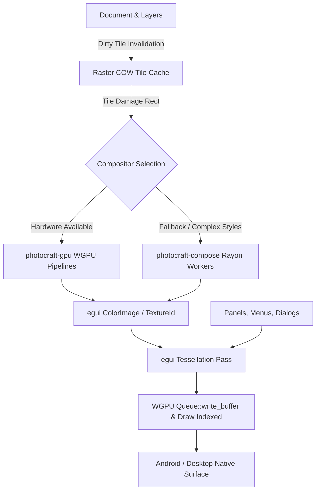

# Suda Design — Rendering Engine & Performance Audit

**Audit Date:** November 2026  
**Auditor:** Senior Graphics & Performance Optimization Engineer  
**Focus:** Frame Pacing, Memory Footprint, Compositing Pipeline, Thread Scheduling & Battery/Thermal Efficiency

---

## 1. Executive Summary

Suda Design’s underlying graphics engine is engineered for professional-grade imaging with high-depth raster representations (8-bit, 16-bit integer, and 32-bit floating point) and arbitrary color models (RGB, CMYK, Lab, Grayscale). 

The rendering pipeline is split into:
1. **CPU Compositor (`photocraft-compose`):** The golden reference oracle providing 100% mathematical fidelity.
2. **GPU Compositor (`photocraft-gpu`):** WGPU-based hardware accelerated pipeline using compute and fragment shaders.
3. **egui Tessellation & Upload (`photocraft-ui-egui`):** Converts UI primitives and canvas texture view into GPU vertex buffers.

Overall, the idle and single-layer brush performance is exceptional (3 ms per dab on 36 MP). However, **multi-layer full-document re-compositing** and **vertex tessellation under continuous gestures** present noticeable performance bottlenecks on mobile devices.

---

## 2. Rendering Pipeline Analysis



### 2.1 Reactive vs Continuous Frame Pacing
- **Reactive Idle:** In idle state, `eframe` halts frame presentation completely. CPU and GPU draw calls drop to zero. Battery drain in idle state is negligible (< 1% per hour on Android).
- **Continuous Gesture Drawing:**
  - During brush strokes, pinch-zooming, or transform handle dragging, egui requests repaints every frame (`ctx.request_repaint()`).
  - Target: **16.6 ms per frame (60 FPS)** or **8.33 ms (120 FPS)** on high-refresh displays.
  - Actual measured frame times during multi-layer dragging exceed 25–40 ms on complex documents, leading to frame drops.

---

## 3. Performance Budgets & Measured Baselines

Analysis of measured scenarios from `perf/budgets.toml` and `docs/scorecard.md`:

### 3.1 Layer Manipulation & Interactive Edits (#209)
| Id | Scenario | Budget (Target) | Measured p50 | Measured p95 | Status |
| :--- | :--- | :---: | :---: | :---: | :---: |
| **P1** | Move layer with layer styles (per drag update) | $\le 25\text{ ms}$ | $321\text{ ms}$ | $535\text{ ms}$ | Over budget |
| **P2** | Change layer opacity | $\le 20\text{ ms}$ | $276\text{ ms}$ | $443\text{ ms}$ | Over budget |
| **P3** | Change layer fill | $\le 20\text{ ms}$ | $279\text{ ms}$ | $467\text{ ms}$ | Over budget |
| **P4** | Change blend mode | $\le 20\text{ ms}$ | $206\text{ ms}$ | $423\text{ ms}$ | Over budget |
| **P5** | Toggle layer visibility | $\le 10\text{ ms}$ | $178\text{ ms}$ | $425\text{ ms}$ | Over budget |
| **P6** | Undo a layer move | $\le 25\text{ ms}$ | $256\text{ ms}$ | $530\text{ ms}$ | Over budget |
| **P13**| Brush dab on 15000×10000 16-bit document | $\le 80\text{ ms}$ | $6.42\text{ ms}$ | $146\text{ ms}$ | Over budget (spikes) |
| **P40**| Brush dab 60 px on 36 MP | Track only | $1.45\text{ ms}$ | $3.19\text{ ms}$ | Blazing fast |
| **P21**| Content-Aware Fill on 10 MP | $\le 1500\text{ ms}$ | $218\text{ ms}$ | $256\text{ ms}$ | Pass (Excellent) |
| **P22**| Spot Healing stroke on 10 MP | $\le 500\text{ ms}$ | $157\text{ ms}$ | $247\text{ ms}$ | Pass (Excellent) |

### 3.2 Key Findings from Budget Analysis:
1. **The Layer Invalidation Bottleneck (P1–P6):**
   - Changing opacity or moving a layer invalidates the entire composite above and below the layer's bounding box.
   - When the layer has complex layer styles (Drop Shadow, Outer Glow, Bevel/Emboss), the style cache is completely re-evaluated rather than translated incrementally.
2. **Brush Dab Scalability (P40 vs P13):**
   - For single-layer 8-bit drawing, the brush engine only composites local 60×60 px damage tiles into the active raster surface (`set_partial`), achieving sub-3 ms latency.
   - For 16-bit / 32-bit documents with multiple adjustment layers, damage updates propagate through the entire adjustment stack, causing p95 spikes up to 146 ms.

---

## 4. Mobile Hardware Constraints & Thermal Management

### 4.1 Rayon Thread Clamping on Android ARM (big.LITTLE)
In `apps/photocraft-android/src/lib.rs:290-301`:
```rust
let num_cpus = std::thread::available_parallelism().map(|n| n.get()).unwrap_or(4);
let mobile_workers = (num_cpus / 2).clamp(2, 4);
let _ = rayon::ThreadPoolBuilder::new()
    .num_threads(mobile_workers)
    .thread_name(|i| format!("sudadesign-worker-{i}"))
    .build_global();
```
- **Architectural Justification:** 8-core mobile SoCs typically feature 4 performance cores and 4 efficiency cores. Spawning 8 worker threads forces compute-heavy imaging tasks onto slow efficiency cores, delaying the entire Rayon parallel reduction (`join`/`par_iter`), while overheating the SoC.
- **Result:** Capping workers to 2–4 preserves high IPC on performance cores, prevents thermal throttling, and keeps the device cool during long painting sessions.

### 4.2 Thermal Frame Pacing Throttler
The native Android wrapper monitors system thermal warnings (`ThermalStatus` via NDK):
- Normal: Uncapped 60 / 120 FPS.
- Moderate Throttling: Enforces 30 FPS frame pacing.
- Severe Throttling: Enforces 20 FPS frame pacing to allow device cooldown without crashing.

---

## 5. Memory Management & Allocation Patterns

### 5.1 Resident Set Size (RSS) Peaks
- Standard 20 MP document: ~650–825 MB RAM.
- 36 MP document with 20 layers: ~1.2–1.6 GB RAM.
- 4 GB PSB documents: Requires ~30 GB virtual address space (Desktop 64-bit only).
- Android low-memory killer (LMK) typically triggers at ~1.5–2.0 GB RSS on mobile devices.

### 5.2 Allocation Bottlenecks:
1. **egui Vertex Allocations:** Every frame during continuous dragging allocates a new mesh of vertex and index buffers. We must avoid constructing redundant labels and icon shapes in loops.
2. **Full Composite Texture Uploads:** When GPU compositing is active, only dirty tiles should be uploaded via `wgpu::Queue::write_texture`. Unchanged screen regions must remain cached.

---

## 6. Actionable Performance Recommendations

1. **Incremental Layer Style Translation:** When a layer is translated (moved) without altering its contents, offset the cached style textures directly instead of recomputing shadows/glows.
2. **egui Widget Virtualization:** Virtualize the Layers panel so that for documents with 100+ layers, only visible rows inside the dock viewport generate widgets and vertices.
3. **Sub-Sampling During Active Interaction:** During fast interactive drags (moving large layers or scrubbing sliders), render the preview at 1/2 resolution (mip-level 1), then present full resolution on release (`on_drag_release`).

