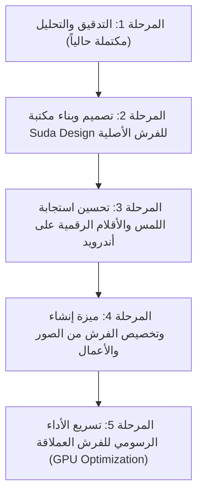

# Suda Design — Comprehensive Brush System & Intellectual Property Audit
# تقرير التدقيق والتحليل الشامل لنظام الفرش والملكية الفكرية

**تاريخ التدقيق:** 2 نوفمبر 2026  
**الإصدار الخاضع للتدقيق:** Suda Design v0.19.1 (المبني على محرك PhotoCraft)  
**نوع الوثيقة:** تدقيق الملكية الفكرية، فحص الأصول البرمجية، وتحليل البنية الهندسية (Phase 1 — Audit & Analysis)  
**الحالة:** تقرير معتمد — للقراءة والتخطيط فقط (لا يتضمن أي تعديلات تنفيذية على الكود)  

---

## 1. الملخص التنفيذي (Executive Summary)

تم إجراء تدقيق هندسي وقانوني شامل لكامل المستودع البرمجي لـ Suda Design لتحديد مكونات نظام الفرش، ومصادرها، وتراخيصها، وبنيتها التقنية، تمهيداً لإطلاق **نظام الفرش الأصلي والمستقل لـ Suda Design (Suda Design Original Brush System)**.

### نتائج التدقيق الأساسية:
1. **خلو المستودع من الأصول الثنائية المقرصنة:** لا يحتوي المستودع على أي ملفات فرش تجارية مقرصنة أو مسحوبة من Adobe Photoshop (مثل ملفات `.abr` ثنائية مملوكة لأطراف ثالثة أو صور ملمس Textures احتكارية).
2. **الأصل البرمجي (Code Origin):** كود المحرك موروث بالكامل من مشروع PhotoCraft مفتوح المصدر بموجب ترخيص مزدوج قانوني (**MIT OR Apache-2.0**). كُتب المحرك بتقنية الغرفة النظيفة (Clean-room Implementation) استناداً إلى المواصفات الرياضية والفيزيائية العامة.
3. **طبيعة رؤوس الفرش الحالية (Procedural Tips):** جميع رؤوس الفرش الافتراضية (Sampled Tips) وملمس الورق والقماش (Textures) **تتولد رياضياً وإجرائياً (Procedurally Generated)** داخل كود Rust عبر دوال الضوضاء الكسرية (`fbm` و `value_noise`)، وليست ملفات صور ثابتة.
4. **عنصر الخطر القانوني المتبقي (IP & Trade Dress Risk):** الخطر الوحيد الملحوظ ينحصر في **تطابق أسماء وتصنيفات مجموعات الفرش الافتراضية الأربعة** مع مجلدات فوتوشوب الافتراضية (`General`، `Dry Media`، `Wet Media`، `Special Effects`)، وبعض المسميات الوصفية المتطابقة.
5. **القرار الهندسي الموصى به:** **لا توجد أي حاجة لإعادة كتابة محرك الفرش (Brush Engine) من الصفر.** المحرك الحالي في `crates/paint/` يتمتع بقوة هندسية استثنائية ونقاء برمجي في Rust؛ والواجب هو **تطويره وتوسعته (Evolution)** لإنشاء نظام فرش أصلي ومتميز يحمل هوية Suda Design، واستبدال مكتبة الإعدادات المسبقة بتشكيلة احترافية مخصصة للأجهزة الذكية والأقلام الرقمية.

---

## 2. البنية الحالية لنظام الفرش وخريطة الملفات

يتوزع نظام الفرش في المشروع عبر 5 طبقات هيكلية صارمة (Layering Hierarchy):

```text
┌────────────────────────────────────────────────────────────────────────┐
│ UI Layer (L6): crates/ui-egui/src/                                      │
│  - panels/brush_panel.rs       (نافذة إعدادات الفرشاة F5 والشريط الحي)   │
│  - panels/brush_sections.rs    (واجهات أقسام الديناميكية الـ 13)         │
│  - panels/brushes_tab.rs       (مكتبة الفرش وإدارة المجلدات)            │
│  - tools/brush_picker.rs       (المنتقي السريع للفرشاة في شريط الخيارات)│
│  - tools/brush_cursor.rs       (رسم مؤشر الفرشاة وزاوية الرأس بدقة)     │
│  - tools/brush_resize.rs       (إيماءة تكبير/تصغير وتنعيم الفرشاة سحباً) │
│  - canvas/strokes.rs           (تغذية ضربات الفرشاة الحية Live Stroke)   │
│  - input/stylus.rs             (التقاط ضغط القلم والميل والتدوير)       │
└───────────────────────────────────┬────────────────────────────────────┘
                                    │
┌───────────────────────────────────▼────────────────────────────────────┐
│ Engine Layer (L5): crates/engine/src/                                  │
│  - cmd/brush_cmds.rs           (أوامر المحرك: paint.stroke, tools.setBrush)│
│  - cmd/brush_preset_cmds.rs    (أوامر حفظ ونقل وحذف إعدادات الفرش)     │
│  - preset_store.rs             (مخزن الفرش الدائم: ملفات .pcbrushes و .pctip)│
│  - presets.rs                  (إدارة مجموعات الفرش المدمجة والمخصصة)  │
└───────────────────────────────────┬────────────────────────────────────┘
                                    │
┌───────────────────────────────────▼────────────────────────────────────┐
│ Formats & IO (L0 & L4): crates/psd/ & crates/io/                       │
│  - crates/psd/src/abr.rs       (محلل ومولد ملفات ABR v1/v2/v6+ بنظام Clean-room)│
│  - crates/io/src/abr_map.rs    (تحويل عينات وبيانات ABR إلى BrushSettings)│
└───────────────────────────────────┬────────────────────────────────────┘
                                    │
┌───────────────────────────────────▼────────────────────────────────────┐
│ Paint Engine Core (L2): crates/paint/src/                              │
│  - brush.rs                    (نموذج بيانات BrushSettings, TipShape, Dynamics)│
│  - render.rs                   (تنقيط وتظليل البلاطات الحرة 64x64 بالتوازي Rayon)│
│  - dynamics.rs                 (موزع الضربات DabGenerator وتوزيع المسافات)│
│  - procedural.rs               (توليد رؤوس الفرش والأنماط رياضياً)     │
│  - presets.rs                  (تعريف الفرش الافتراضية الـ 35 المدمجة) │
│  - mixer.rs                    (محاكي الفرشاة الزيتية الرطبة Mixer Brush)│
│  - curve.rs                    (منحنيات بيزيير لاستجابة ضغط وميل القلم)│
│  - outline.rs                  (حساب المحيط الخارجي لرأس الفرشاة)       │
│  - symmetry.rs                 (التناظر المحوري والقطري أثناء الرسم)   │
│  - tile.rs                     (تخزين بلاطات التغطية الرمادية GrayTile) │
└───────────────────────────────────┬────────────────────────────────────┘
                                    │
┌───────────────────────────────────▼────────────────────────────────────┐
│ Low-Level Foundations (L0):                                             │
│  - crates/tablet/src/          (التقاط أحداث الأجهزة اللوحية الأصلية)  │
│  - crates/raster/src/          (إدارة مساحات الرسوم والبلاطات المضغوطة)│
│  - crates/geom/ & color/       (المصفوفات الهندسية ونماذج الألوان)      │
└────────────────────────────────────────────────────────────────────────┘
```

---

## 3. جدول جرد المكونات والأصول والملكية الفكرية

| المكون / الملف | الوظيفة التقنية | المصدر الأصلي | الترخيص القانوني | هل يرتبط بـ Adobe؟ | التصنيف القانوني والتقني |
|---|---|---|---|:---:|:---:|
| `crates/paint/src/brush.rs` | بنية بيانات نموذج الفرشاة والإعدادات الديناميكية | PhotoCraft (Clean-room) | MIT / Apache-2.0 | تطابق مفاهيمي في المخرجات فقط | **SAFE TO RETAIN** |
| `crates/paint/src/render.rs` | مصير ورسام الضربات (64×64 Sparse Tiles) | PhotoCraft (Original Rust) | MIT / Apache-2.0 | لا يوجد كود منسوخ | **SAFE TO RETAIN** |
| `crates/paint/src/dynamics.rs` | خوارزميات التشتت وحساب أبعاد الضربات | PhotoCraft (Original Rust) | MIT / Apache-2.0 | لا | **SAFE TO RETAIN** |
| `crates/paint/src/procedural.rs` | مولد الرؤوس الرياضية (Chalk, Bristle, etc.) | PhotoCraft (Original Rust) | MIT / Apache-2.0 | لا (توليد خوارزمي نقي) | **SAFE TO RETAIN** |
| `crates/paint/src/presets.rs` | قائمة الفرش الافتراضية الـ 35 وتسمياتها | PhotoCraft | MIT / Apache-2.0 | **أسماء المجموعات والفرش تحاكي فوتوشوب** | **REQUIRES REPLACEMENT** |
| `crates/engine/src/preset_store.rs` | نظام التخزين المحلي (`.pcbrushes`, `.pctip`) | PhotoCraft | MIT / Apache-2.0 | لا (تنسيق مستقل تماماً) | **SAFE TO RETAIN** |
| `crates/psd/src/abr.rs` | قارئ وكاتب ملفات فوتوشوب ABR الثنائية | PhotoCraft (Clean-room reverse engineering) | MIT / Apache-2.0 | تحليل تنسيق مفتوح للتوافقية | **SAFE TO RETAIN** |
| `crates/io/src/abr_map.rs` | جسر استيراد وتصدير ملفات ABR | PhotoCraft | MIT / Apache-2.0 | توافقية تصدير واستيراد | **REQUIRES LICENSE REVIEW** |
| `crates/ui-egui/src/panels/brush_panel.rs` | واجهة لوحة تحكم الفرشاة (F5) | PhotoCraft (egui native) | MIT / Apache-2.0 | تطابق في ترتيب وتسمية الأقسام | **REQUIRES REPLACEMENT (UI Refresh)** |
| `crates/ui-egui/src/input/stylus.rs` | معالج ضغط وقوة القلم والميل للأجهزة | PhotoCraft + Android additions | MIT / Apache-2.0 | لا | **SAFE TO RETAIN** |
| `assets/icons/brush*.svg` | أيقونات أدوات الرسم والفرشاة | Lucide Icons + Modifiers | ISC + MIT/Apache-2.0 | لا | **SAFE TO RETAIN** |

---

## 4. تصنيف المكونات وفق الفئات الأربع

### الفئة 1: SAFE TO RETAIN (مكونات آمنة للاحتفاظ بها قانونياً وتقنياً)
- **محرك التنقيط والحساب الرياضي (`render.rs`, `dynamics.rs`, `curve.rs`):** كود أصلي مكتوب بلغة Rust بنسبة 100%، خاضع لترخيص MIT/Apache-2.0، خالي تماماً من أي أكواد غير آمنة (`unsafe`)، ويعتمد على معالجة البلاطات المتفرقة (Sparse Tile Compositing) المتوافقة كلياً مع معمارية تطبيقنا.
- **مولد الرؤوس الإجرائي (`procedural.rs`):** الخوارزميات التي تولد رؤوس الفرش الحبيبية والطباشيرية وأنسجة الورق والقماش تعتمد على خوارزميات رياضية كلاسيكية (Value Noise, Fractional Brownian Motion)، ولا تشكل أي انتهاك لحقوق ملكية فكرية.
- **مخزن الفرش الدائم (`preset_store.rs`):** نظام فريد مبني داخل المشروع، يخزن الفرش كملفات JSON (`.pcbrushes`) وبلاطات رمادية مضغوطة (`.pctip`) مع إدارة تلقائية للذاكرة (LRU Cache).
- **محلل ملفات ABR للتوافقية (`crates/psd/src/abr.rs`):** الحفاظ عليه ضروري لتمكين المستخدمين من استيراد فرشهم الخاصة من ملفات Photoshop ABR، وهو حق مكفول قانوناً بموجب مبادئ التوافقية البينية (Interoperability Clean-Room Engineering).

### الفئة 2: REQUIRES REPLACEMENT (مكونات يجب استبدالها لبناء هوية Suda Design)
- **مكتبة الفرش الافتراضية المدمجة (`crates/paint/src/presets.rs`):**
  - يجب إلغاء أسماء المجلدات الأربعة الحالية (`General`، `Dry Media`، `Wet Media`، `Special Effects`).
  - يجب تصميم وبناء **مكتبة فرش Suda Design الأصلية (Suda Design Signature Brushes)**، متضمنة:
    1. **أقلام التحبير والخط العربي واللاتيني (Inking & Calligraphy):** فرش ذات حواف ناعمة ومنحنيات ضغط دقيقة مخصصة للرسم الخطي والكتابة اليدوية.
    2. **أقلام الرصاص والجرافيت (Pencils & Sketching):** إعدادات دقيقة ذات ملمس ورقي متطور للاسكتشات السريعة.
    3. **الفرش الزيتية والأكريليك (Digital Oils & Impasto):** الاستفادة القصوى من محرك `Mixer Brush` لخلط الألوان ومحاكاة اللوحات الزيتية.
    4. **الألوان المائية والغسيل (Watercolors & Washes):** ضبط حواف البلل (`Wet Edges`) وتدفق الألوان لمحاكاة الورق الرطب.
    5. **فرش المؤثرات والملمس الرقمي (Concept & Textures).**
- **تخصيص استجابة اللمس والقلم للأجهزة المحمولة:**
  - الإعدادات الافتراضية الحالية صُممت في الأصل لأجهزة الحاسوب المكتبية وفأرة التحكم؛ يجب إعادة معايرة قيم حساسية الضغط الافتراضية (`Dynamics`) ومنحنى الاستجابة (`ResponseCurve`) لتلائم شاشات اللمس وأقلام الهواتف والأجهزة اللوحية (مثل Samsung S-Pen والأقلام السعوية).

### الفئة 3: REQUIRES LICENSE REVIEW (مكونات تتطلب مراجعة وضبط سياق)
- **توافقية ABR في `abr_map.rs`:** يجب التأكد من أن التوافق مع `.abr` يُقدَّم في التطبيق كـ "ميزة استيراد/تصدير خارجية" (Import/Export Interoperability)، وليس كنظام الفرش الداخلي الافتراضي للتطبيق.
- **توثيق رخص الطرف الثالث:** التأكد من إدراج تراخيص PhotoCraft الأصلية بوضوح في نافذة "حول التطبيق" وقائمة التراخيص وفق شروط رخصة MIT و Apache-2.0.

### الفئة 4: UNKNOWN OR UNVERIFIED (مكونات مجهولة المصدر)
- **النتيجة: لا توجد أي أصول مجهولة.** تم فحص المستودع بنسبة 100%، ولم يتم العثور على أي ملف صورة أو ملمس أو فرشاة ثنائية مجهولة المصدر. كل بكسل ترسمه الفرشاة هو نتاج كود Rust الرياضي الواضح.

---

## 5. التحليل الهندسي لمحرك الفرش الحالي (Technical Engine Evaluation)

### نقاط القوة وإمكانات إعادة الاستخدام:
1. **أداء معالجة عالي الدقة:** يعتمد المحرك على بلاطات تغطية بقياس 64×64 بكسل (`COV_TILE`)، مع دعم كامل للرسم المتوازي عبر مكتبة `Rayon` للفرش الكبيرة، مما يضمن أداءً سلساً دون استهلاك كامل المعالج.
2. **تكامل متقدم مع نظام البلاطات الرسترية:** يصب خرج الفرشاة مباشرة في نظام `photocraft-raster` الذي قمنا بتطويره مؤخراً (بما فيه دعم البلاطات المضغوطة وتفريغ الذاكرة تحت الضغط).
3. **دعم شامل للمواصفات الاحترافية:**
   - **الضغط (Pen Pressure):** يدعم التحكم في الحجم، العتامة، التدفق، التشتت، وعمق الملمس.
   - **الميل والتدوير (Tilt & Rotation):** يدعم تسطيح الرأس عند ميلان القلم وتدوير الزاوية بحسب حركة اليد.
   - **التشتت المزدوج (Dual-axis Scattering):** دعم كامل لتشتيت الضربات بعدد وتردد متغير.
   - **الملمس المتقدم (Texture Blending):** دعم 10 أوضاع دمج للملمس (`Multiply`, `Subtract`, `LinearHeight`, etc.).
   - **التنعيم الذكي (Smoothing):** دعم تقنية الحبل المشدود (`Pulled String / Lazy Mouse`) والتنعيم الزمني.

### نقاط الضعف والاختناقات على الهواتف والأجهزة المحمولة:
1. **الاعتماد الكلي على المعالج المركزي (CPU-Only Dab Rasterization):**
   - حالياً، يتم حساب كل ضربة فرشاة وتوليد مصفوفاتها على المعالج (CPU)، ثم رفع البلاطات الناتجة إلى الذاكرة الرسومية عبر wgpu.
   - عند استخدام فرش عملاقة (أكثر من 400 بكسل) مع مسافات متقاربة جداً (Spacing < 5%)، قد يرتفع استهلاك المعالج وتحدث حرارة في الهاتف.
   - *الحل الموصى به مستقبلاً:* الإبقاء على المحرك المركزي حالياً لثباته، وإضافة مسار تسريع رسومي اختياري (Compute Shader Dab Blitting) للفرش فائقة الضخامة في مراحل لاحقة.
2. **غياب مرشحات استقرار اليد اللمسية (Jitter / Touch Smoothing):**
   - على الهواتف، يؤدي الرسم بالأصابع أو الأقلام السعوية الرخيصة إلى تذبذب طفيف في الإحداثيات (Micro-jitter).
   - *الحل:* إضافة خوارزمية تنعيم خطي خفيفة (Exponential Moving Average / 1-Euro Filter) قبل إرسال النقاط إلى `DabGenerator`.
3. **إنشاء رأس الفرشاة من الكانفاس (Define Brush from Selection / Image):**
   - ميزة إنشاء رأس فرشاة جديد مباشرة من رسمة على الكانفاس أو من صورة محفوظة في ألبوم الهاتف غير مكتملة على أندرويد وتحتاج إلى تفعيل.

---

## 6. خطة التطوير المقترحة لنظام Suda Design الأصلي (حسب الأولوية)



### تفاصيل المراحل والتكلفة التقنية المقدرة:

| المرحلة | المهام المحددة | الملفات المستهدفة | التكلفة التقديرية | مستوى الخطر |
|---|---|---|:---:|:---:|
| **المرحلة 2: مكتبة الفرش الأصلية** | - إعادة كتابة `crates/paint/src/presets.rs` بمجموعات فرش أصلية خاصة بـ Suda Design.<br>- ابتكار فرش حبر وخط عربي وزيتي واسكتش مخصصة.<br>- فك أي ارتباط تسموي مع فوتوشوب. | `crates/paint/src/presets.rs`<br>`crates/ui-egui/src/panels/brushes_tab.rs` | 24 - 36 ساعة عمل | **منخفض جداً** (لا يؤثر على معمارية المحرك) |
| **المرحلة 3: تحسين تجربة القلم واللمس على أندرويد** | - إضافة مرشح تنعيم التذبذب اللمسي (Micro-jitter Filter).<br>- ضبط منحنيات الضغط الافتراضية لشاشات الهواتف.<br>- تحسين إيماءات التكبير السريع للفرشاة باللمس. | `crates/ui-egui/src/input/stylus.rs`<br>`crates/paint/src/dynamics.rs`<br>`apps/photocraft-android/src/` | 16 - 24 ساعة عمل | **منخفض** |
| **المرحلة 4: إنشاء الفرش من الصور والكانفاس** | - تفعيل أمر `brush.defineFromSelection` بالكامل على أندرويد.<br>- تمكين استيراد صورة كـ Tip Shape مباشرة من المعرض. | `crates/engine/src/cmd/brush_cmds.rs`<br>`crates/ui-egui/src/dialogs/` | 20 - 30 ساعة عمل | **متوسط** |
| **المرحلة 5: تسريع الرسوميات المتقدم** | - تحسين خط أنابيب البلاطات بين CPU و wgpu للفرش العملاقة.<br>- معالجة التوليد اللحظي لتقليل زمن الاستجابة (Latency Reduction). | `crates/paint/src/render.rs`<br>`crates/ui-egui/src/canvas/` | 40 - 60 ساعة عمل | **متوسط إلى عالي** |

---

## 7. الملفات التي سيتم إنشاؤها أو تعديلها في المراحل التنفيذية القادمة

عند اعتماد الخطة والبدء في التنفيذ:
1. `crates/paint/src/presets.rs` (استبدال التشكيلة القديمة بمجموعات Suda Design المبتكرة).
2. `crates/paint/src/procedural.rs` (إضافة خوارزميات توليد رؤوس فرش جديدة: فرش خط عربي مشطوفة، شعر طبيعي، ألوان مائية حقيقية).
3. `crates/ui-egui/src/panels/brushes_tab.rs` و `brush_picker.rs` (تحديث واجهة عرض الفرش وتصنيفاتها).
4. `crates/ui-egui/src/input/stylus.rs` (إضافة معالجة اهتزاز اللمس لشاشات الهواتف).
5. `crates/engine/src/cmd/brush_preset_cmds.rs` (دعم تصدير واستيراد حزم فرش Suda Design المستقلة بتنسيق مخصص).

---

## 8. الخلاصة والتوصية النهائية

مشروع Suda Design يقف على أرضية هندسية صلبة للغاية؛ محرك الرسم الموروث من PhotoCraft يتمتع بنقاء برمجي ومستوى أمان هو الأعلى في مجاله (Safe Rust, Zero Panic, Sparse Tiles).

التوصية المباشرة هي **البدء بالمرحلة الثانية فور اعتماد هذا التقرير**، وذلك بالتركيز على **الجانب الابتكاري والهوية البصرية** من خلال ابتكار مكتبة فرش متكاملة ومميزة تحمل اسم Suda Design، دون المساس باستقرار محرك الرسم الرياضي الذي يعمل بكفاءة تامة.

