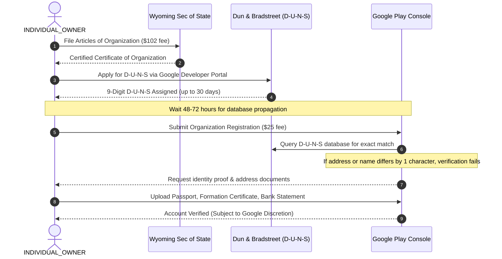

# Google Play Organization Developer Account Readiness Guide
## Publisher Entity: Suda Design LLC (Wyoming, USA — Unincorporated)

**Document Reference:** GP-ORG-2026-02  
**Status:** DRAFT — PREPARATION & VERIFICATION GUIDE (NO ACCOUNT CREATED)  
**Target Account Type:** Organization (Corporate / Enterprise Developer Account)  

---

> [!WARNING]
> **DISCRETIONARY VERIFICATION WARNING**  
> Google’s developer organization verification process is strict, automated, and subject to administrative discretion. Registration does **not guarantee** immediate approval, exemption from testing protocols, or acceptance of third-party address services. All steps must be prepared with documentary evidence.

---

## 1. Overview of Organization Account Considerations

Google Play mandates identity verification for all developer accounts under its developer verification standards.

### 1.1. Organization vs. Personal Account Realities
1. **Testing Policies:** While personal developer accounts registered after November 2023 are subject to the mandatory **20-tester closed testing requirement for at least 14 days**, Organization accounts currently follow a different onboarding flow. However, **Google does NOT guarantee blanket exemption from app review or testing requirements**; Google reserves the right to request testing or verification for any developer or application.
2. **Public Transparency:** Organization accounts display the verified corporate legal name (`Suda Design LLC`) and official address on the Google Play Store listing.
3. **Legal Separation:** Contractual agreements with Google LLC are entered into by the LLC, shielding the individual owner from personal contract privity.

---

## 2. Pre-Requisites Subject to Google Verification

| Item | Requirement Specification | Verification Challenge / Google Rule | Status |
| :--- | :--- | :--- | :---: |
| **1. Legal Corporate Name** | Must match certified Wyoming Articles of Organization exactly (including punctuation). | Automated check against official state business registers. | Pending Formation |
| **2. D-U-N-S Number** | 9-digit identifier issued by Dun & Bradstreet. | Name, address, and zip code in D&B must **exactly match** Google Console input. D&B sync can take days to weeks. | Pending Formation & D&B Application |
| **3. Physical Business Address** | Verified address of the company. | **CAUTION:** Google frequently rejects commercial registered agent addresses, virtual offices, or P.O. boxes. Google may demand utility bills, lease agreements, or bank statements in the company’s name. | High Scrutiny Risk |
| **4. Corporate Domain & Website** | Publicly accessible website on the company’s domain (e.g., `https://sudadesign.app`). | Must display the company’s legal name, contact details, and Privacy Policy. | In Development |
| **5. Domain Email Address** | Primary contact email on the corporate domain (e.g., `contact@sudadesign.app`). | Generic free emails (`@gmail.com`) face heightened review friction. | Pending Domain Setup |
| **6. Business Phone Number** | Direct phone number capable of receiving SMS codes or verification calls. | Virtual VoIP numbers may occasionally fail automated carrier checks. | Required |
| **7. Authorized Officer ID** | Valid, unexpired government-issued passport of `INDIVIDUAL_OWNER`. | Color scan showing all corners, with zero glare. | Prepared |
| **8. US Business Bank Account** | Corporate bank account matching the exact legal name of `Suda Design LLC`. | Verified via Google Payments deposit or bank letter. | Post-EIN Stage |

---

## 3. D-U-N-S Number Timeline and Verification Flow

---

## 4. Specific Verification Risks & Mitigation Strategies

1. **Commercial Registered Agent Address Scrutiny:**
   - *Risk:* Google Play verification automated systems detect shared registered agent addresses (e.g. 30 N Gould St, Sheridan, WY) and may flag them as virtual offices, suspending account verification.
   - *Mitigation:* Be prepared to provide an official corporate bank statement displaying the company's address, or consider physical commercial co-working/office solutions if Google requires physical premises documentation.
2. **Account Transition Strategy (Official App Transfer vs. In-Place Conversion):**
   - *Google Policy Reality:* Google Play does **NOT** permit converting an existing personal/individual developer account into an organization account in-place.
   - *Official Procedure:* The intended, supported, and compliant roadmap is:
     1. Publish and operate Suda Design initially under the verified Individual Developer Account.
     2. Establish Suda Design LLC approximately 3 months later and register a separate Google Play Organization Developer Account with verified D-U-N-S and business credentials.
     3. Submit an official **Google Play App Transfer Request** (`support.google.com/googleplay/android-developer/answer/6230247`) transferring `com.sudadesign.app` from the Individual account to the Organization account.
     4. Google's official transfer seamlessly migrates the application, preserving all installs, ratings, reviews, store rankings, and user statistics without downtime.

---

## 5. Official References & Google Play Documentation
- **Google Play Help — Developer Account Verification:** https://support.google.com/googleplay/android-developer/answer/13962645
- **Google Play Help — Verification Requirements by Country:** https://support.google.com/googleplay/android-developer/answer/10841920
- **Dun & Bradstreet — D-U-N-S for Google Developers:** https://www.dnb.com/duns-number/get-a-duns-number.html
