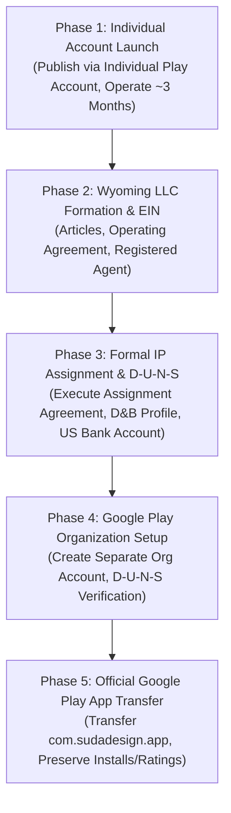

# Corporate Migration & IP Transition Framework
## From Individual Ownership to Wyoming LLC (Planning Model)

**Document Reference:** CORP-MIG-2026-02  
**Status:** DRAFT — STRATEGIC PLANNING FRAMEWORK (NO TRANSFER EXECUTED)  
**Originating Party:** Natural Person (`INDIVIDUAL_OWNER`)  
**Target Entity:** Single-Member LLC in Wyoming, USA (`FUTURE_WYOMING_LLC` — Unincorporated)  

---

## 1. Executive Purpose & Legal Pre-Conditions

This document outlines the planned sequential transition of commercial operations, intellectual property, and app store publishing rights from **`INDIVIDUAL_OWNER`** to a future corporate vehicle (**`FUTURE_WYOMING_LLC`**):

> [!IMPORTANT]
> **NO TRANSFER PRIOR TO INCORPORATION:**  
> The target corporate entity does not currently exist. No intellectual property, domain name, trademark, or software code has been transferred. All proprietary assets remain the property of `INDIVIDUAL_OWNER` until:
> 1. Articles of Organization are stamped and approved by the Wyoming Secretary of State.
> 2. The Operating Agreement is formally executed.
> 3. The formal Intellectual Property Assignment Agreement (`legal/company/IP_ASSIGNMENT_TO_WYOMING_LLC.md`) is signed by both parties.

---

## 2. Inventory of Proposed Transferable Assets

### 2.1. Proprietary Assets Eligible for Assignment:
1. **Trademarks & Brand Identity:** Rights in the mark "Suda Design", monogram "Sd", color-splash artwork, app launcher icons, trade dress, and associated goodwill.
2. **Original Code Modifications:** Custom Android GameActivity harness, JNI bindings, IME touch keyboard pipeline, and mobile responsive layout adaptors.
3. **Digital Real Estate:** Domain registrations (e.g., `sudadesign.app`), official web content, and social media accounts.
4. **Commercial Documentation:** Proprietary EULA, Terms of Use, Privacy Policy, and internal guidelines.

### 2.2. Excluded Non-Transferable Assets (Upstream & Open Source):
1. **PhotoCraft Core Engine:** Copyright (c) 2026 ArtCraft Team and PhotoCraft contributors (Dual MIT / Apache-2.0). The LLC receives no ownership, only standard licensee rights under MIT/Apache-2.0.
2. **Third-Party Open-Source Crates:** All 359 runtime crates remain the property of their respective copyright holders.
3. **Bundled Fonts & Icons:** Inter, JetBrains Mono, BIZ fonts, and Lucide icons remain under their inbound open-source licenses.

---

## 3. Five-Phase Transition Roadmap (Individual Launch to Corporate Transfer)

---

## 4. Phase-by-Phase Governance Protocols

### Phase 1: Individual Account Launch & Initial Operation (Current Status)
- Publish the first public release of Suda Design through the verified Individual Google Play Developer Account registered under `INDIVIDUAL_OWNER`'s legal identity.
- Maintain and update the application under package name `com.sudadesign.app`.
- Successfully complete the mandatory 20-tester, 14-day Closed Testing track protocol.
- Operate and maintain the application under the individual account for approximately 3 months, establishing initial user metrics, reviews, and market stability.

### Phase 2: Wyoming LLC Organization (~3 Months Post-Launch)
- Perform official name availability search via Wyoming Secretary of State portal.
- Appoint a licensed Wyoming Commercial Registered Agent with a verified physical street address.
- File Articles of Organization ($100 state fee + $2 online convenience fee).
- Adopt Single-Member Operating Agreement establishing `INDIVIDUAL_OWNER` as 100% sole equity member.
- Obtain federal Employer Identification Number (EIN) via IRS Form SS-4.

### Phase 3: Formal IP Assignment & Organizational Verification
- Execute formal **Intellectual Property Assignment Agreement** (`legal/company/IP_ASSIGNMENT_TO_WYOMING_LLC.md`) transferring proprietary Suda Design code, trademarks, and brand assets to Suda Design LLC.
- Open US corporate business bank account matching the exact legal name of Suda Design LLC.
- Apply for a 9-digit D-U-N-S Number from Dun & Bradstreet (allow up to 30 days standard processing).

### Phase 4: Google Play Organization Account Setup
- Register a **separate, dedicated Google Play Organization Developer Account** in the legal name of Suda Design LLC ($25 registration fee).
- Complete Google Play organizational verification using the certified Articles of Organization, corporate bank statement, and D-U-N-S number.
- Ensure the organization account is fully verified and active before initiating application migration.

### Phase 5: Official Google Play Application Transfer
- Initiate the official **Google Play App Transfer Procedure** (`support.google.com/googleplay/android-developer/answer/6230247`).
- Requirements for transfer:
  1. Source Account: Individual Developer Account (Transaction ID / Registration receipt).
  2. Target Account: Suda Design LLC Organization Account (Transaction ID / Registration receipt).
  3. Package Name: `com.sudadesign.app`.
- **Preservation of Key Metrics:**
  - Application ID (`com.sudadesign.app`) is preserved 100% without change.
  - Active installs, total downloads, and user base are seamlessly retained.
  - All user ratings, written reviews, and star averages remain intact.
  - Historical analytics, store rankings, and keyword indexing continue without disruption.
  - Google Play App Signing key transfers automatically with the app.
- Update the public store listing developer contact information to Suda Design LLC.

---

## 5. Official References
- **Google Play Help — Transfer apps to a different developer account:** https://support.google.com/googleplay/android-developer/answer/6230247
- **Wyoming Secretary of State — Business Division:** https://wyobiz.wyo.gov/
- **Dun & Bradstreet — D-U-N-S for Google Developers:** https://www.dnb.com/duns-number/get-a-duns-number.html
- **Google Play Developer Account Types & Requirements:** https://support.google.com/googleplay/android-developer/answer/13962645
